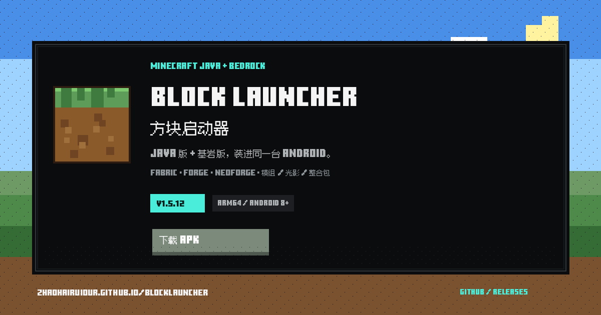

# BLOCK LAUNCHER

**方块启动器 · Minecraft Java + Bedrock，装进一台 Android 设备。**

[](https://github.com/zhaohairuiour/BlockLauncher/releases/latest)
[](https://github.com/zhaohairuiour/BlockLauncher/releases/latest)
[](https://github.com/zhaohairuiour/BlockLauncher/releases/latest)

[下载最新 APK](https://github.com/zhaohairuiour/BlockLauncher/releases/latest) · [产品介绍页](https://zhaohairuiour.github.io/BlockLauncher/) · [全部版本](https://github.com/zhaohairuiour/BlockLauncher/releases)



## 这是什么

BlockLauncher 是一个原生 Android 启动器，使用 Kotlin + Jetpack Compose 构建。界面采用 Minecraft 像素风格：硬边面板、抖动阴影、青色强调色和官方像素字体。

它把 Java 版启动链和 Bedrock 客户端入口放进同一个应用：从账号、版本清单、加载器安装，到 JRE、触控布局和游戏内 HUD，都在本地完成。

## 功能

- Java 版与 Bedrock 版入口
- 微软正版登录 / 离线账号
- Mojang、BMCLAPI 版本清单
- 版本继承链与版本隔离
- 并发下载、断点续传
- Fabric / Quilt / Forge / NeoForge 安装器
- Modrinth / MC百科内容检索
- 模组、光影、资源包、整合包下载
- Java 8 / 17 / 21 运行时管理，缺失 Java 21 时自动获取
- Pojav / Amethyst 运行层、GL4ES、OpenAL
- FCL 风格触控布局编辑器与自定义 HUD
- JVM 日志落盘、上次会话恢复、退出码记录

## 下载

| 项目 | 值 |
| --- | --- |
| 最新版本 | **1.5.12** |
| 发布日期 | 2026-11-21 |
| 包名 | `com.blocklauncher.app` |
| 架构 | `arm64-v8a` |
| 最低系统 | Android 8.0 / API 26 |
| 安装包 | 约 17 MB |
| 签名 | 固定证书，可直接覆盖安装 |

前往 [Releases](https://github.com/zhaohairuiour/BlockLauncher/releases/latest) 下载 APK。

```text
SHA-256 (BlockLauncher-1.5.12.apk)
91a7f99b3bbb3a1a087a66ed2fff661a376672f6f0b407851899a2cc412b40f1
```

## 安装

1. 下载 `arm64-v8a` APK。
2. 允许浏览器或文件管理器安装未知来源应用。
3. 使用微软账号登录，或创建离线账号。
4. 在版本库选择游戏版本；需要时安装 Fabric / Forge 等加载器。
5. 首次启动会准备 Java 运行层，随后进入游戏。

更新版本使用同一签名证书，直接覆盖安装即可，账号、版本与存档会保留。

## 当前版本状态

`1.5.12` 解决两个实际阻塞问题：

- **JRE 执行权限**：运行层扫描、启动前检查和安装完成后统一修复 `jre21/bin/java` 执行位。1.5.10 已安装到本地的旧 JRE 不用重新下载；截图中的 `Permission denied / trying to exec .../bin/java` 由这条路径处理。
- **触控编辑器布局**：编辑对话框限制在屏幕宽高内，正文独立滚动，底部按钮固定；检查器在宽屏改左右双栏，窄屏改底部面板，不再覆盖画布右侧；顶部工具栏支持横向滚动。
- 保留 1.5.11 的日志捕获、jar 校验和 Java 21 选择逻辑。

已知问题：运行时权限修复后，1.21.11 可能继续暴露下一层 JVM / Minecraft 报错，不能仅凭这次修复视为已稳定运行。如果仍退出码 1，请把 `logs/` 下的最新日志发到 Issue。日志目录：

```text
Android/data/com.blocklauncher.app/files/BlockLauncher/logs/
```

## 产品介绍页

GitHub Pages 站点位于：

**https://zhaohairuiour.github.io/BlockLauncher/**

站点与 App 共用同一套视觉资产：`minecraft_pixel.ttf`、草方块图标和 Overworld 配色。页面源码在 `docs/`。

## 仓库结构

```text
.
├── docs/                  # GitHub Pages 站点
│   ├── index.html
│   └── assets/
│       ├── site.css
│       ├── minecraft-pixel.ttf
│       ├── icon.svg
│       └── og.png
├── README.md
└── .gitignore
```

## 反馈

- Bug 与启动日志：[Issues](https://github.com/zhaohairuiour/BlockLauncher/issues)
- 版本记录：[Releases](https://github.com/zhaohairuiour/BlockLauncher/releases)

提交启动问题时，请附上设备型号、Android 版本、游戏版本、加载器和 `logs/` 目录中的最近日志。

## 说明

本项目目前以闭源方式发布，仓库只包含发布产物与介绍页，不包含完整 App 源码。

BlockLauncher 不是 Mojang Studios 或 Microsoft 的官方产品。Minecraft 是 Mojang Studios 的商标。
